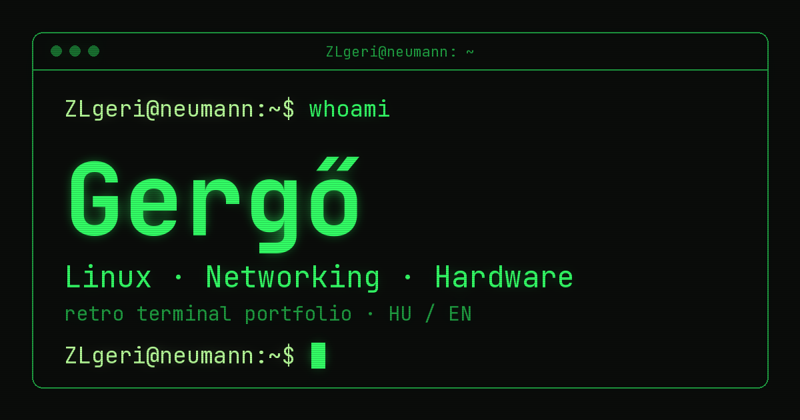

# terminal-cv

My personal portfolio as a retro terminal. Live at **[zlgeri.com](https://zlgeri.com)**.



Type commands like in a real shell, or click them. Everything is bilingual (Hungarian / English).

```
ZLgeri@neumann:~$ help
  about      about me (whoami, cat about.txt)
  skills     skills
  hardware   my machines (neofetch)
  projects   projects
  contact    contact
  lang       language: lang en | lang hu
  theme      theme: green | amber | mono
  clear      clear the screen
```

## Features

- **Real terminal feel:** typed commands, aliases (`whoami`, `cat about.txt`, `neofetch`), `Tab` completion,
  `↑`/`↓` history, `Ctrl+L` to clear, and a few easter eggs (try `sudo`).
- **Clickable too:** every command in the output and in the bottom bar is a button, so it works on phones.
- **Bilingual:** picks Hungarian or English from the browser language; `lang en` / `lang hu` or the toolbar
  button switches it. The choice is remembered.
- **Three CRT themes:** green, amber and mono, with scanlines and glow.
- **Zero dependencies, no build step:** three plain files (HTML, CSS, JS), about 20 KB of code.
- **Content separated from logic:** all texts and data live in `i18n.js`; `terminal.js` only contains behaviour.
- **Accessible:** output is an `aria-live` region, controls are real buttons with focus styles.

## Security

The site is static, but it is still treated like production:

- **Strict Content-Security-Policy** set by the web server: `default-src 'none'`, scripts, styles, images and
  fonts only from the site itself, no inline scripts, no framing. This is why the fonts are self-hosted.
- **No XSS from user input:** what you type is echoed as a text node, and the "command not found" message
  escapes it before it is inserted as HTML.
- `X-Content-Type-Options`, `Referrer-Policy` and `Permissions-Policy` headers are set as well.
- `localStorage` access is wrapped, so the site still works when storage is blocked.

## Project structure

```
index.html     markup, meta tags, Open Graph preview card
style.css      CRT look, themes (CSS custom properties), mobile layout
i18n.js        CONFIG (name, links), HARDWARE (neofetch data), I18N (all texts, HU + EN)
terminal.js    the shell: command table, parser, history, completion, theme/language switching
fonts/         JetBrains Mono, Latin + Latin Extended subsets (SIL OFL 1.1)
og.png         1200×630 social preview image
```

## Run locally

Any static file server works:

```bash
python3 -m http.server 8000    # then open http://localhost:8000
```

## Customising

- **Your own details:** edit `CONFIG`, `HARDWARE` and the texts in `i18n.js`. Strings can use tokens such as
  `{name}`, `{email}` or `{github}`, which are filled in from `CONFIG`.
- **A new command:** add a function to `COMMANDS` in `terminal.js` (return an array of lines, a string of
  HTML, or `null`), then add a `help.list` entry for it in both languages in `i18n.js`.

## Hosting

The site runs on my own Raspberry Pi at home: nginx serves the files, and a Cloudflare Tunnel publishes them
over HTTPS without opening any port on the home router. Cloudflare caches every file at the edge, so the
site stays up even if the Pi briefly goes offline. A deploy script copies the files to the Pi, purges the
cache and warms it up again.

The whole setup (scripts, nginx config, tunnel config) is documented in my
[homelab](https://github.com/zlgeri/homelab) repository.

## Credits

Built by me, with an AI assistant (Claude) as a coding partner. It helped with parts of the implementation,
reviewed the code and explained things along the way. The concept, the content and the decisions are mine,
and I host, deploy and maintain the site myself.

## License

- Code: [MIT](LICENSE)
- Font: JetBrains Mono, [SIL Open Font License 1.1](fonts/OFL.txt)
- The personal content (texts in `i18n.js`, `og.png`) describes me. Feel free to learn from the code,
  but please don't publish my details as your own.
